# Manual – Inventory Stock Counting (Stock Counting App)

This manual describes how to use and configure Stock Counting in the Florisoft Inventory App. It covers the user workflow, associated policies and authorization in one document. Detailed instructions for parcel photos are provided in a separate manual.

---

## Requirements

- Florisoft Inventory App with access to Stock Counting
- Backoffice Stock module
- Stock Control module
- The correct [authorization](#authorizations) and configured policies for the user

The **JobAgent** must be running for printing. Parcel photos require configured photo storage and availability through the webshop.

---

## What is Stock Counting?

Stock Counting lets you compare physical stock with the stock registered in Florisoft. Scan or search for a parcel, check its quantities and properties, and confirm the check. Where permitted, you can correct stock, register a quality issue, take a parcel photo or print labels.

A scan registers a **Scan quantity**. This is a separate record: scanning is a different action from changing the stock quantity or confirming the parcel as checked.

---

## Workflow steps

1. Prepare the stock count in the Backoffice.
2. Open Stock Counting and scan or search for a parcel.
3. Check the parcel using the configured counting strategy.
4. Adjust quantities, location or other permitted details where needed.
5. Optionally register a quality issue, take a photo or print labels.
6. Confirm the check and review the result in the Backoffice.

The following sections explain the actions and their policies. Instructions for [configuration through Policy Management](#where-to-find-the-stock-counting-policies) appear later in this manual.

---

## Step 1 – Prepare the stock count

Open the stock screen in the Backoffice and review which parcels need to be checked.

<b>Click here for an example!</b>
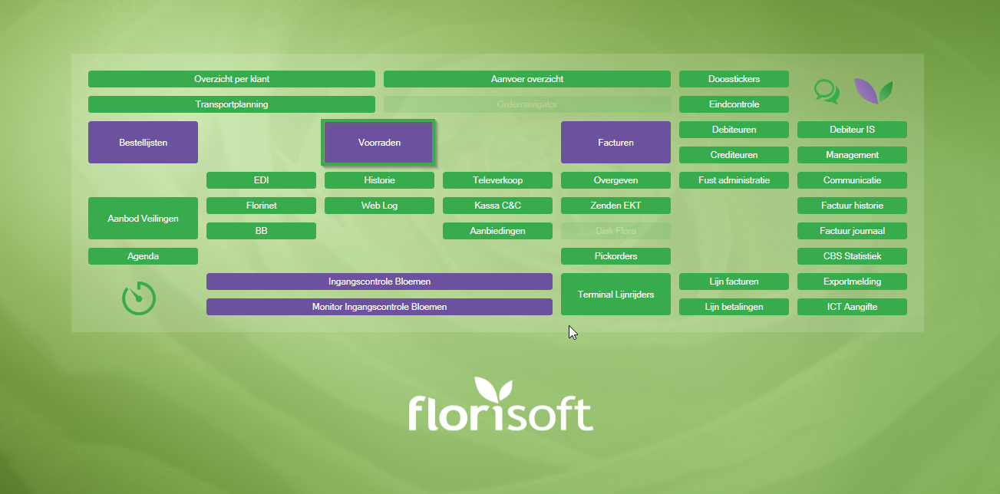

Activate stock counting through **Options → Stock counting → Activate**. Stock lines checked with the app are highlighted in green in this overview.

<b>Click here for an example!</b>
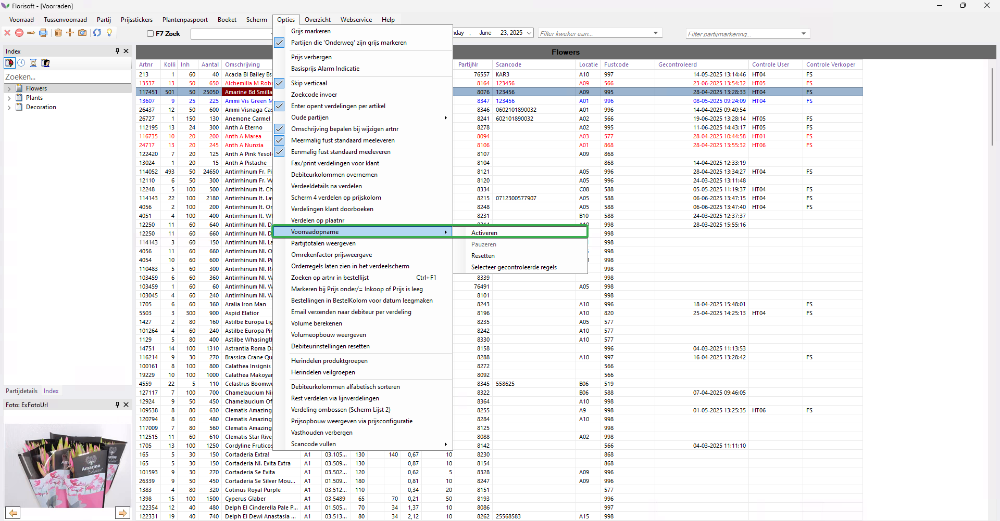

---

## Step 2 – Open Stock Counting and find a parcel

Open the Inventory App from the Florisoft Hub app or its own app icon. Log in with your credentials and select the **Stock Counting** tile. Select an employee if the app prompts you to do so.

<b>Click here for an example!</b>
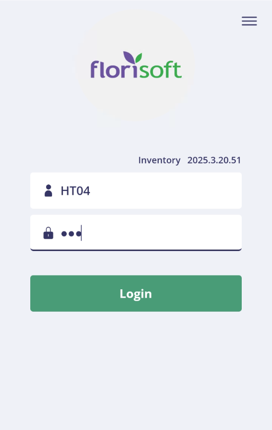

<b>Click here for an example!</b>
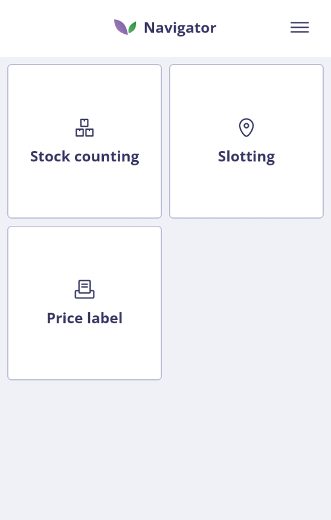

Scan a parcel barcode or open the search screen. The lookup searches the article description or `Scancode`. For numeric input, the app also searches the last four digits of the parcel number. Enter at least three characters to refresh the search results; clear the search box to load the list without a text filter.

The lookup uses a different search route from the barcode scanner. Searching by V-parcel number or `Scancode2` is not a separately supported option in this text box. After selecting a result, choose **Select stock item** to open the detail page. A scan opens this page automatically; if there are multiple results, select the correct parcel first.

<b>Click here for an example!</b>
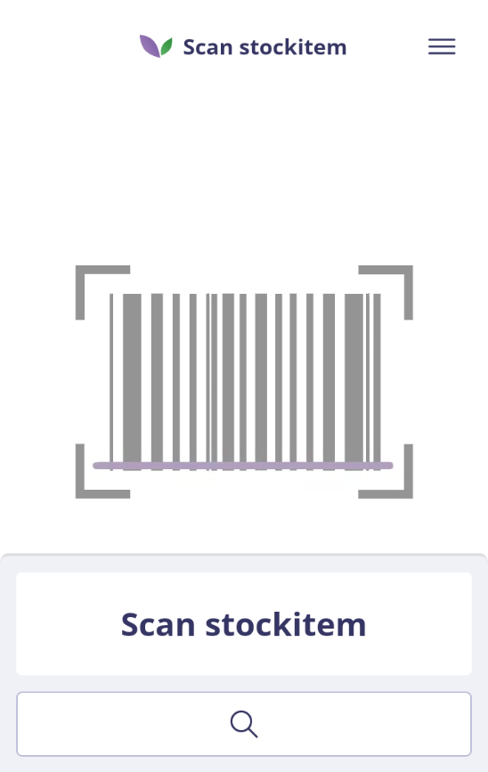

<b>Click here for an example!</b>
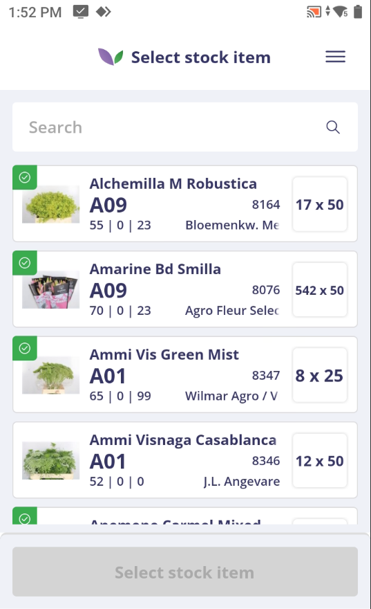

### Available parcels, filters and display

| Policy | Behavior |
| --- | --- |
| `AvailableStocks` | Restricts available parcels to the specified stocks. Configure this list explicitly: with an empty list, the lookup does not apply a stock filter. When counting by V-parcel, the order also determines which underlying parcels are adjusted first. |
| `StockItemDetailSettings_AvailableStockItemFilterOptions` | Defines which search filters are available and their order. Filters can be offered for stock, packaging, supplier, shipment number, empty parcels, stem length, product group and parcel marks. |
| `ToPickQuantityDisplay` | Shows the remaining quantity to pick as total stems or as colli × content + remainder. The policy default is **Stems**; check the effective value in your policy profile. |
| `StockItemDetailSettings_StockItemQuantityDisplay` | Shows the parcel quantity as colli × content + remainder or as total stems. |

Under **Apps → Inventory**, `DisplayedStockItemIdentifier` selects **PartijNr** (`StockItemNr`) or **VPartijNr** (`VStockItemNr`) as the displayed identifier. The app shows its last four digits. This level also contains `ToPickQuantityDisplay` for the Inventory-wide display; for Stock Counting, check the setting within its own use case.

### Apply and reset search filters

Open the filter button next to the search box, select the required values and apply the filter. The button shows the number of active filter fields. The reset action clears additional filters but retains the text in the search box. Clear that box separately to remove the text restriction as well.

The product-group selector only shows groups used by parcels within the configured stocks. An existing product group without corresponding parcels is therefore absent from this selector. The unique-carrier strategy limits the lookup to parent parcels with carriers; the partial-parcel strategy limits it to parents with a partial parcel that has no unique carrier.

Note the current behavior of **Empty Items** (`EmptyItems`): enabling this filter only shows parcels with free stock greater than 0. It does not produce a list of empty parcels only. Reset it when searching for parcels with zero or negative free stock as well.

### Register scan quantity

A resolved parcel scan increases **Scan quantity** after the correct parcel has been selected. The increase follows the sales unit in the stock setting (`VERKEH`):

| Sales unit | Increase per parcel scan |
| --- | --- |
| Stems | 1 |
| Bunch | Content of one bunch |
| Sales unit | The parcel's sales unit content |
| Colli | Content of one colli |
| Box | Content of one box; if empty or 0, the content of one colli is used. |

Without a valid sales unit, Scan quantity increases by 1. Manually searching for and selecting a parcel does not increase Scan quantity.

The increase is at least 1, including when a configured bunch, sales-unit or colli content is missing. In V-parcel counting, the scan is registered on the underlying parcels within the available stocks; the displayed Scan quantity is the sum of their registrations. One scan can therefore add more than the content of one underlying parcel. A direct unique-carrier scan opens the carrier without performing this separate parcel-scan registration.

Add `ScanQuantity` to the visible parcel details to show the counter. Also add it to the editable details if users may correct it manually or reset it to **0**.

---

## Step 3 – Count using the configured strategy

`StockCountingStrategy` determines which stock object is checked.

| Value | Workflow |
| --- | --- |
| `StockItem` – Count individual parcels | Each selected parcel is counted and confirmed separately. |
| `VstockItem` – Count by V-parcel | Searching and scanning continue to work at parcel level. After selection, parcels sharing the same VPartijNr within `AvailableStocks` are processed as one consolidated count. |
| `UniqueCarrier` – Count by unique carrier | Count one physical unique carrier. The parent parcel is only fully checked after all associated carriers have been confirmed. |
| `PartialStockItem` – Count by partial parcel | Count a partial parcel without an associated unique carrier. Confirmation immediately marks both the selected partial and its parent parcel as checked. This does not mean that every other partial has been counted separately. |

### Counting by V-parcel

The order of `AvailableStocks` determines the processing order of underlying parcels. Quantity changes are allocated across these parcels. Detail changes, check marks and quality registrations are processed on the underlying parcels within the selection. Printing uses the first underlying parcel in this order.

> **Data requirement:** all stock records with the same VPartijNr must have the same colli content (`INHKOLLI`). Different values can cause an incorrect colli and remainder breakdown even when the total quantity is correct. Use a separate VPartijNr for different colli contents, or count individual parcels. This requirement also applies when scanning a barcode containing PARTIJNR: processing still takes place at VPartijNr level after selection.

### Counting by unique carrier

Scan the unique carrier directly, or scan/search for the parent parcel first. If only one carrier is available, the app opens it directly; otherwise select the correct carrier. The carrier must have status `Arrived`.

The carrier ID, location and quantity belong to the selected carrier. Other parcel details remain properties of the parent parcel. Configure the unique-carrier printer and layout if you want to print carrier labels.

### Counting by partial parcel

Scan or search for the parent parcel, then select the partial parcel. If only one partial is available, the app opens it directly. Partial parcels have no separate scannable barcode. Partials associated with a unique carrier are handled through the unique-carrier strategy.

Location and quantity belong to the selected partial. A quantity correction also adjusts the parent parcel; other details remain properties of the parent parcel. Check the other partials separately, even if the parent parcel is already marked as checked.

<b>Click here for an example of the parcel detail!</b>
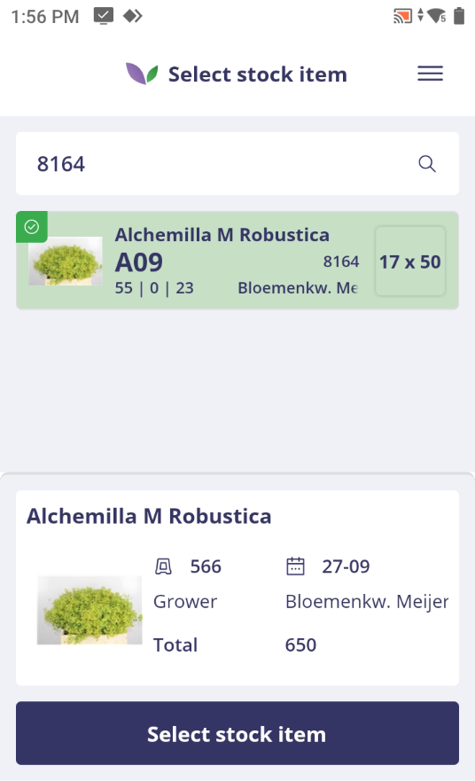

---

## Step 4 – Check and adjust details

Compare the physical stock with the quantities and properties in the parcel detail. An orange banner indicates that the parcel was checked previously.

For ordinary parcels, the displayed total contains free stock plus the remaining quantity from open pick orders. V-parcel counting aggregates the relevant underlying parcels. For a unique carrier or partial parcel, use the quantity of that selected stock object.

If **Exclude pick orders from stock counting** (`PICKNOOPN`, **Pickorders niet meetellen in voorraad opname**) is enabled under **Relation settings → Distribution** for a pick order's customer, that pick order is excluded. If there are no eligible pick orders, the **To pick** row is hidden.

### Visible and editable parcel details

The policy group is named `StockItemDetailSettings` and contains:

| Policy | Behavior |
| --- | --- |
| `AvailableStockitemDetails` | Selects the visible properties and their display order. |
| `AllowEditStockitemDetails` | Determines which visible properties the user may change. Making a field visible does not make it editable. |
| `StockItemQuantityDisplay` | Controls quantity display, as described in step 2. |
| `AvailableStockItemFilterOptions` | Controls the available search filters, as described in step 2. |
| `AllowManageStockItemPhotos` | Allows taking or replacing parcel photos, as described in step 6. |

The following properties are available:

| Property | Policy value | Editable when permitted |
| --- | --- | --- |
| Location | `Location` | Yes |
| Colli | `Colli` | Yes |
| Colli content | `ContentColli` | Yes |
| Remainder | `Remainder` | Yes |
| Sales unit | `SalesUnit` | Yes |
| Packaging code | `PackagingCode` | Yes |
| Bunch content | `ContentBunch` | Yes |
| Purchase price | `PurchasePrice` | Yes |
| Sales price | `Price` | Yes |
| Price groups 1, 2 and 3 | `PriceGroup1`, `PriceGroup2`, `PriceGroup3` | Yes |
| Parcel mark | `StockItemMark` | Yes |
| Total | `Total` | Yes |
| Days old | `DaysOld` | Yes |
| Latest scan time | `LatestScanTime` | No |
| Scan code | `ScanCode` | Yes |
| Webshop visibility | `WebshopVisibility` | Yes |
| Scan quantity | `ScanQuantity` | Yes |
| Box content | `ContentBox` | Yes |
| Stock description | `StockDescription` | No |
| Quality code | `QualityCode` | Yes |

For example, add `QualityCode` to both lists if a user needs to see and change the quality code. Stock description and Latest scan time always remain read-only.

### Enter a scan code using the scanner

First select the **Scan code** field in the parcel detail, then scan the required barcode. If `ScanCode` is editable, the app enters the scanned value in that field. This scan does not open the next parcel. Without edit permission, a message appears and the scan code is not changed.

Leave the scan-code field selection before using a barcode to move to another parcel. Confirm the changed scan code through the normal save action.

### Change webshop visibility and parcel marks

The **Webshop visibility** field controls whether the parcel is visible on the webshop. Add `WebshopVisibility` to both visible and editable details, change the selection and save it with the other changes. The app shows the functional meaning of the selection. The `VoorraadBlock` system setting determines how this maps to the existing Backoffice X/IBLOCK value; do not manually invert the selection in the app. Reopen the parcel to check the current saved value.

Select a **Parcel mark** from the centrally available marks. The selector shows the description and its color, if configured. `StockItemMark` must also be visible and editable. **Packaging code** also uses a selector; **Quality code** is a text field.

### Adjust total and colli consistently

Changing **Total** recalculates the number of colli and the remainder using the colli content. Changing **Colli**, **Colli content** or **Remainder** recalculates the total as colli × content + remainder.

During a change, you can use one of these two input methods: changing the total temporarily disables the separate quantity fields; changing the separate fields disables the total. Restore the changed quantity fields to their original values to make the other input method available again. Configured edit permissions still apply. Colli content must be at least 1; colli and remainder cannot be entered as negative values.

### Increase or decrease quantities

The Inventory-wide `Apps_Inventory_SalesUnit` policy sets the quantity increment: **Stems**, **Bunch**, **Sales unit**, **Colli**, **Box** or **Use stock sales unit** (`UseStock`). Without a policy value, the existing **CC sales unit** is used. With `UseStock`, the app follows the stock's sales unit, using Colli when no value is set.

For **Box**, the app uses box content, or colli content when box content is empty or 0. The minimum increment is 1. This setting does not change the separate Scan quantity registration.

### Change location

If `Location` is visible and editable, you can enter or scan a location. With `CheckPredefinedLocationCodes`, the app only accepts codes registered in **Parcel locations** (`PARTIJLOC`) in the constants screen. An unknown location is rejected and the existing location is retained.

This validation replaces normal recognition based on location length and character format. Fully numeric codes can also be used when registered in advance. Without this policy, the `LocatieVeldLengte` system setting affects location recognition. Coordinate changes to that setting with your administrator.

<b>Click here for an example!</b>
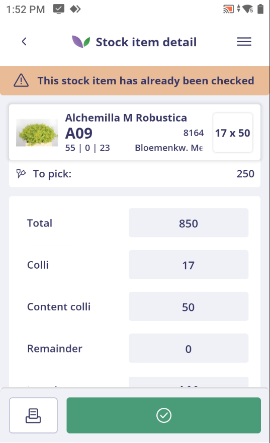

### Process stock differences

The `StockMutationSettings` policy group controls how quantity corrections are processed:

| Policy | Behavior |
| --- | --- |
| `StockMutationAsCounting` | Processes stock differences through a counting distribution to the configured stock-count customer. A valid customer must be configured and the stock must permit this processing. |
| `StockCountingCustomerCode` | Sets the general stock-count customer, used in processing with `StockMutationAsCounting`. |
| `StockCountingCustomerCodePerStock` | Uses the stock's **Stock count debtor** setting instead of the general customer. Keep the general customer configured as well. Users need the corresponding Backoffice policy permission to change the stock setting. |
| `StockCountingXorder` | Also creates a new xorder/pick order for a counting distribution with a difference. This requires processing through `StockMutationAsCounting`; it does not by itself reduce existing customer pick orders. |
| `StockQuantityMutAlsoStoredStockItem` | Also applies stock quantity changes to linked logistics parcels. The lowest logistics parcel is adjusted first. |
| `ReducePickItemsOnStockDecrease` | Allows a stock correction to reduce existing open pick orders when free stock is insufficient. Check the effective policy value: it can fall back to the existing Backoffice setting. |

### Correct open pick orders when stock is insufficient

When `ReducePickItemsOnStockDecrease` is enabled, eligible open pick orders for the same V-parcel can be reduced, from newest to oldest. V-parcel counting first reduces available free stock, then applies any remaining shortage to eligible pick orders.

Settings outside the Stock Counting policy group also apply:

- `Backoffice_Logistics_Stock_Counting_OrderPickStockCodes` selects eligible pick-order stocks. An empty effective list produces no candidates. This list is separate from `AvailableStocks`.
- Pick orders whose customers have **Exclude pick orders from stock counting** enabled are excluded from correction.
- `Apps_Inventory_StockCorrectionExceptionReasonId` selects the reason for automatically created distribution controls. Under **Apps → Inventory**, select an existing valid reason from **Distribution control reason** (`VERDCONT`). Without a valid reason, registration can fail.
- The `OpnamePartijAltijdMuteren` system setting controls whether negative parcel stock can be saved. Disabling it does not automatically repair stock that is already negative and does not disable pick-order correction.

`StockMutationAsCounting` and `StockCountingXorder` control counting bookkeeping and creation of a new pick order. `ReducePickItemsOnStockDecrease` separately controls changes to existing pick orders.

> **Important for stock corrections:** after processing, reopen and check the stock total, changed pick orders and distribution controls. In individual-parcel counting, negative free stock combined with pick-order reductions can produce an unexpected reopened total. Combining corrections with newly created counting pick orders also requires checking. Distribution-control registration can fail after stock or pick orders have already changed. Review the Backoffice before repeating the same correction. Coordinate configuration of this process with Florisoft.

---

## Step 5 – Register quality issues (optional)

Swipe the product header to the left in the parcel detail and tap the trash icon. Select a reason, enter the quantity and add a comment if needed. Then confirm the registration.

The icon only appears when `QualityIssue_Authorization` is enabled and the integrated **Quality Issue Registration** functionality is available to the user. Enabling the policy alone is insufficient if access to this functionality is missing.

<b>Click here for an example!</b>
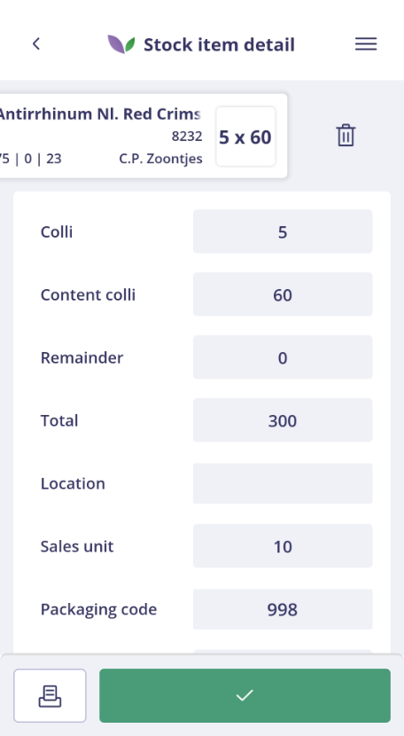

<b>Click here for an example!</b>
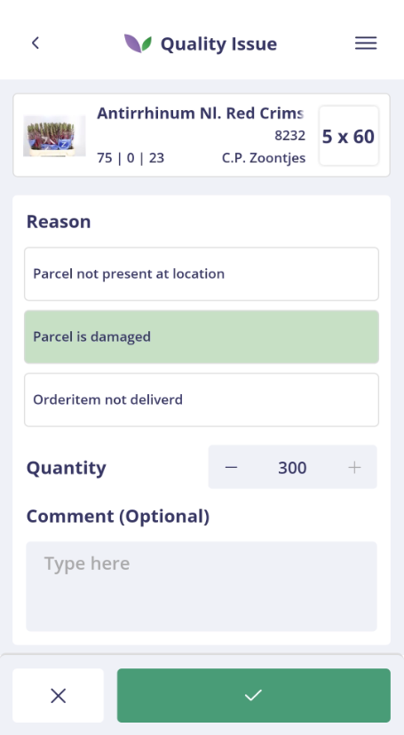

The comment is saved in the distribution memo. The selected reason is recorded in the parcel log. V-parcel processing follows the available-stock order. For a partial parcel, a quantity reduction also affects the parent parcel.

After successful registration, you return to the parcel detail and the app reloads quantities. Unsaved changes to other parcel properties are retained and still need to be saved separately. Check the new total before making further corrections.

The `QualityIssue` policy group contains:

| Policy | Behavior |
| --- | --- |
| `Authorization` | Allows quality registration. Disabled (`False`) by default. |
| `CustomerCode` | Determines the customer to which quality issues are booked. Set it explicitly if quality issues need separate registration; the existing stock-count customer is used as the default. |
| `Reasons` | Selects the reasons users may choose. A reason is required when registering an issue. |

Manage reasons through **Financial → Credit Reason**. Add a reason with type description **Distribution control reason** (**Verdeelcontrole reden**) and enter a clear description. Then select the intended reasons in `Reasons`. If the selection list is empty, check whether the reasons were created in the correct list type. The app does not automatically check translations here.

The user-selected quality reason is separate from `StockCorrectionExceptionReasonId`. The policy for correcting open pick orders does not add automatic pick-order correction to this quality registration.

---

## Step 6 – Take or change a parcel photo (optional)

`StockItemDetailSettings_AllowManageStockItemPhotos` allows users to take or replace a camera photo from the parcel detail. Uploading from the gallery or files is not supported. Photo management in the partial-parcel strategy is currently unsupported.

For operating instructions, upload messages, photo storage and webshop processing, consult the separate manual [Technical operation – Taking or changing parcel photos](Technical%20operation%20%E2%80%93%20Taking%20or%20changing%20parcel%20photos.md).

---

## Step 7 – Print price, stock or carrier labels (optional)

Open the print dialog from the parcel detail, enter the required quantities and choose **Print**. For ordinary price and stock labels, no job is sent when both quantities are zero.

If you have unsaved changes, the app first asks you to save them before printing. Review the old and new values and choose **Save** or **Cancel**. Cancelling or a failed save stops printing. For unique carriers, the app then asks whether to print the selected carrier's label; the ordinary price- and stock-label quantity dialog is not shown.

V-parcel printing uses the first underlying parcel according to the stock order. For partial parcels, the ordinary parcel label uses parent-parcel details; its quantity and location are not replaced by the partial's details. For unique carriers, the selected carrier's label is printed.

<b>Click here for an example!</b>
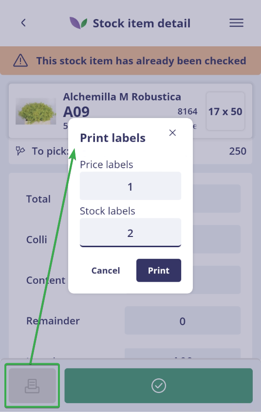

The `PrintSettings` policy group contains:

| Policy | Behavior |
| --- | --- |
| `AvailablePrinters` | Enables price labels and stock labels using `Price` and/or `Stock`. Select both to offer both label types. |
| `PriceLabelPrinter` | Printer for price labels. |
| `PriceLabelLayout` | Choose the layout for price labels. Layouts of list types 70 and 83 are available. |
| `PriceLabelPrinterDescription` | Price-label printer description shown in the app. |
| `StockLabelPrinter` | Printer for stock labels. |
| `StockLabelLayout` | Layout for stock labels. |
| `StockLabelPrinterDescription` | Stock-label printer description shown in the app. |
| `UniqueCarrierLabelPrinter` | Printer for unique-carrier labels. |
| `UniqueCarrierLabelLayout` | Layout for unique-carrier labels. |

Printing requires the corresponding printer and layout. The **JobAgent** must also be running. Consult the [JobAgent manual](https://github.com/florisoft/User.Manuals/blob/main/CLOUD%20APPLICATIONS/Apps%20Windows/Job-Agent/Manual%20Job-Agent%20-%20EN.md).

---

## Step 8 – Confirm and continue

Press the green button to confirm the check and save any changes. If there are changes, an overview first shows the old and new values. Choose **Save** to process them or **Cancel** to remain in the current detail without saving them.

You can also scan the next parcel or unique carrier directly from the detail. If there are changes, the same confirmation overview appears first; cancelling keeps you on the current parcel. Without changes, the app performs the check confirmation before opening the next selection. Always review the confirmation or message before continuing.

If saving fails, the app does not open the next scanned parcel or execute a subsequent print action. If a warning appears, check which processing has taken place.

<b>Click here for an example!</b>
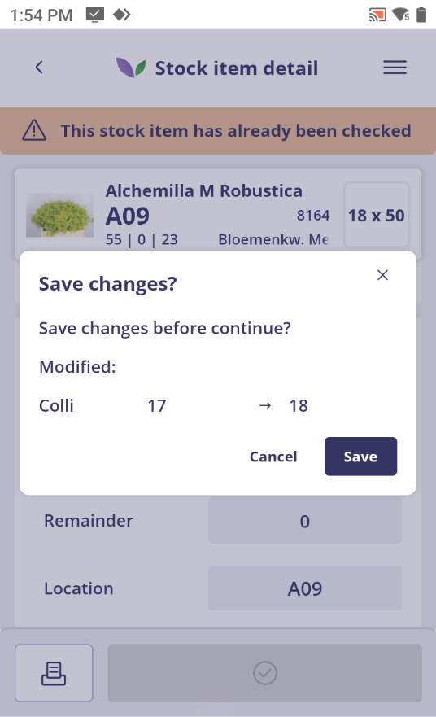

<b>Click here for an example!</b>
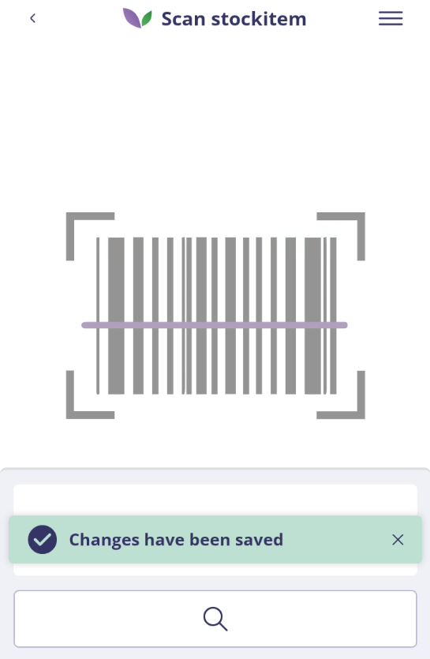

### Update pick-check status

`PickCheckStocks` sets the stock codes of parcels whose pick-check status should be updated while processing changes. It is a stock-code list in a text setting, rather than an on/off option. Without an explicit policy value, the existing Backoffice setting can be used.

### Automatically mark a parcel as received

Select `MarkAsReceived` in `AdditionalActions` to also mark the parcel as received when saving parcel changes. This requires a valid **Entry Control** license (`Logistics.Receiving.EntryControl`). Confirming a check without changes is a separate action; do not rely on it as confirmation that receiving has been performed. Check the receiving status in your process.

---

## Step 9 – Review in the Backoffice and finish

After confirmation, the corresponding stock line is highlighted in green and contains the date and time, user and associated salesperson. Account for each strategy's completion rules: a unique-carrier parcel is only complete once all carriers are confirmed; confirming a partial immediately marks the parent parcel as checked.

Open the distribution screen from the stock line to review recorded distributions.

<b>Click here for an example!</b>
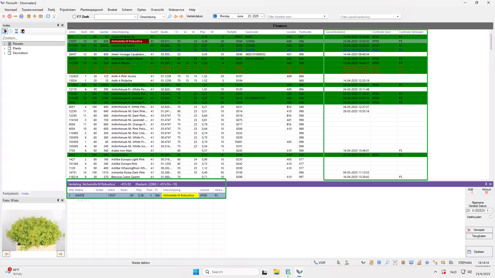

Repeat the check for every stock object to be counted. Review unmarked lines and resolve any differences. Only reset the stock-counting screen once the round is finished, through **Options → Stock counting → Reset**. You can then start again for the next count.

<b>Click here for an example!</b>
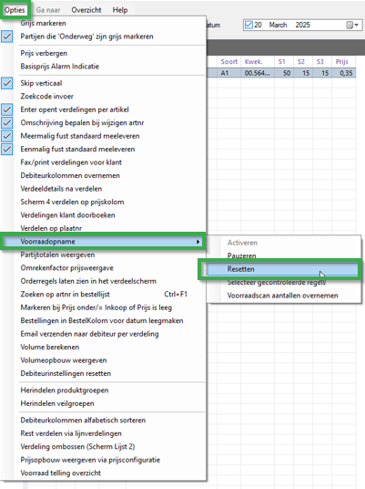

---

## Where to find the Stock Counting policies

| Step | Explanation |
| --- | --- |
| **1** | Open the constants screen in the Backoffice through the navigator. |
| **2** | Navigate to **System → Users → Policy Management**. |
| **3** | Select or create a policy and navigate to **Apps → Inventory → Stock Counting**. |
| **4** | For details, mutations, quality registration or printing, open the relevant group: **StockItemDetailSettings**, **StockMutationSettings**, **QualityIssue** or **PrintSettings**. |

Policy names in this manual are relative to this route. For example, `StockItemDetailSettings_AllowManageStockItemPhotos` is the full policy `Apps_Inventory_StockCounting_StockItemDetailSettings_AllowManageStockItemPhotos`.

The shared settings `DisplayedStockItemIdentifier`, `ToPickQuantityDisplay`, `SalesUnit` and `StockCorrectionExceptionReasonId` are one level higher under **Apps → Inventory**. The referenced Backoffice and system settings have their own routes. Always check the effective policy for the user and situation; existing Backoffice values may supply defaults.

For general management, consult the [Policy Management manual](https://github.com/florisoft/User.Manuals/blob/main/BASIS/Policy%20Management/Manual%20Policy%20Management%20EN.md).

---

## Authorizations

The correct authorization is required to open and use Stock Counting.

| Step | Explanation |
| --- | --- |
| **1** | Open the constants screen through the navigator. |
| **2** | Navigate to **System → Users → System users**. |
| **3** | Open the user and choose **Authorization**. |
| **4** | Press **F3** to open the search window. |
| **5** | Search for code **425** and select **Navigator palmtop/Stock counting_425**. Choose **All actions allowed** and confirm with **OK**. |
| **6** | Repeat for other users or use **Copy authorization**. |

Policies for editable details, photos and quality registration then determine which actions are available within Stock Counting.
