# Handleiding – Final Outbound Check (Quality Control App)

Deze handleiding beschrijft het gebruik en de inrichting van **Final Outbound Check** in de Florisoft Quality Control App. De volledige workflow en alle bijbehorende policies staan in dit document. Voor geïntegreerde functies, zoals foto’s en fustregistratie, wordt verwezen naar de aparte handleidingen.

**Benodigdheden:**

* Florisoft Quality Control App
* Final Outbound Check-licentie

## Wat is Final Outbound Check?

Met Final Outbound Check controleert u of de juiste artikelen en aantallen gereedstaan voor uitlevering. U werkt binnen een actieve selectie, in de app ook een **scope** genoemd. Dit kan één klantorder zijn, een huborder, een groep orders van een klant of hub, een datumgroepering of een paklijst. De groepering bepaalt welke orderregels samen worden gecontroleerd en op welke orders vervolgacties werken.

## Stappenplan Final Outbound Check

1. Meld aan in de Quality Control App.
2. Selecteer de order, groep orders of paklijst die u wilt controleren.
3. Controleer orderregels en dozen via scannen of handmatige invoer.
4. Controleer de voortgang en voer de gewenste aanvullende acties uit.

## Stap 1: Inloggen in de Quality Control App

Open de Quality Control App vanuit de Florisoft Hub-App of via het Quality Control App-icoon. Log in met uw gebruikersgegevens. Selecteer een medewerker als de app daarom vraagt. De aangemelde gebruiker en medewerker worden bij de controle vastgelegd.

<b>Klik hier voor een voorbeeld!</b>
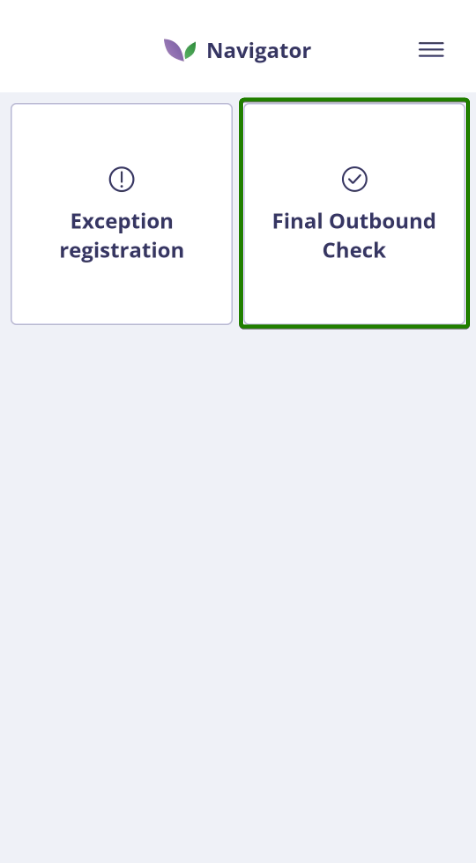

 

> ℹ️ Als de Quality Control App nog niet is geïnstalleerd, download deze dan via de Florisoft Hub-App. Raadpleeg hiervoor de installatiehandleiding: [Hub-App Installatie NL](https://github.com/florisoft/User.Manuals/blob/main/CLOUD%20APPLICATIONS/App%20Hub/Hub-App%20Installatie%20NL.md)

## Stap 2: Order selecteren

Om te kunnen starten met het controleren van een order, moet eerst een openstaande klantorder geselecteerd worden. Dit kan op twee manieren:

### Optie 1: Scannen van een barcode

Scannen van de barcode van een orderregel, bijvoorbeeld een pickordersticker. Hiervoor moet de juiste barcode-instelling geactiveerd zijn via de policy `BarcodeDecodeOptions`.

Op het startscherm kunt u ook een **klantbarcode**, **doosbarcode** of **paklijstbarcode** gebruiken om de bijbehorende controle te vinden. Voor een paklijst moet `EnablePickingListProcessing` aan staan. Een losse partij- of V-partijbarcode wordt gebruikt binnen een al geopende controle, niet om vanuit dit startscherm een order te openen.

De startscan selecteert de controle en telt de gescande orderregel of doos nog niet als gecontroleerd. Scan daarvoor opnieuw in het actieve controleoverzicht. Bij één passende selectie opent de app deze direct; bij meerdere kiest u eerst de juiste. Is de gekozen selectie al volledig gecontroleerd, dan kan de app direct het overzicht met aanvullende acties openen. Tik daar op **Check** om de controleregels alsnog te bekijken.

<b>Klik hier voor een voorbeeld!</b>
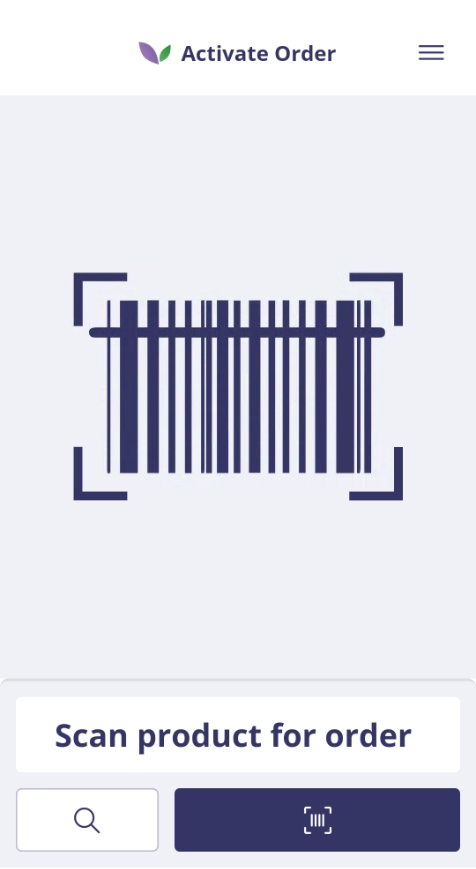

> ℹ️  Wanneer de policy `AllowScanningRedistributedBarcodes` is ingeschakeld, kan het voorkomen dat bij het scannen meerdere resultaten worden gevonden, bijvoorbeeld bij herverdeelde artikelen. In dat geval verschijnt automatisch een keuzescherm waarin het juiste orderitem geselecteerd moet worden om het scanproces te vervolgen.

<b>Klik hier voor een voorbeeld!</b>
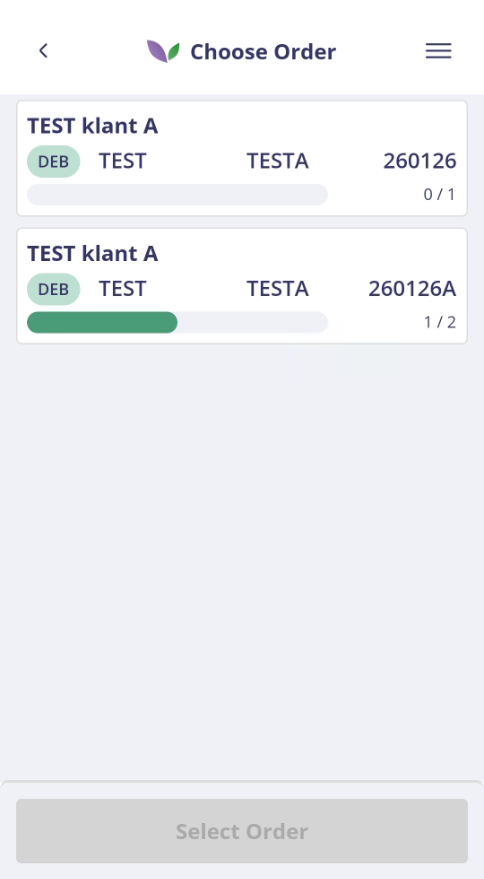

### Optie 2: Order zoeken via zoekicoon

Door het zoekicoon te gebruiken wordt een orderoverzicht getoond. Dit overzicht laat alle beschikbare klantorders zien. De weergave van dit overzicht kan naar eigen voorkeur ingesteld worden. De bijbehorende policies staan onder `OrderOverview` binnen Final Outbound Check. Voer minimaal drie zoektekens in om gericht te zoeken of maak het zoekveld leeg voor het volledige beschikbare overzicht. Gebruik de verversactie wanneer het overzicht opnieuw moet worden geladen.

<b>Klik hier voor een voorbeeld!</b>
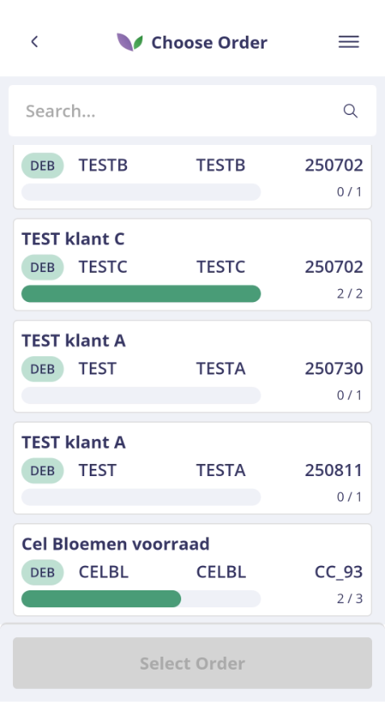

### Welke orders zijn beschikbaar?

De groep `OrderOverview_Filters` bepaalt de selectie:

| Policy | Werking |
| --- | --- |
| `EnableFilters` | Schakel `IsFinalOutboundCustomer` in om alleen orders van debiteuren met **Is eindcontrole debiteur** op te halen. Dit is een lijst met filteropties, geen algemene aan/uit-knop voor alle onderstaande filters. |
| `ScopeDateFilterType` | Kies `None` voor geen datumfilter, of filter op `OrderDate`, `DepartureDate`, `DeliveryDate` of `PurchaseDate`. |
| `ScopeDateFromDays` | Bepaalt hoeveel dagen vóór vandaag het datumbereik begint. Gebruik bijvoorbeeld `2` voor eergisteren. |
| `ScopeDateToDays` | Bepaalt hoeveel dagen na vandaag het datumbereik eindigt. Gebruik `0` voor vandaag of `1` voor morgen. |
| `ExcludeOrderNumber` | Sluit de opgegeven ordernummers uit. De vergelijking is op het volledige ordernummer: `FUST` sluit niet automatisch ieder ordernummer uit waarin die tekst voorkomt. |
| `FilterStockCodes` | Beperkt de orderregels tot de gekozen voorraadcodes. Zonder voorraadcodes wordt geen voorraadfilter toegepast. |

Het datumfilter, de uitsluitlijst en de voorraadselectie worden afzonderlijk toegepast, ook als `EnableFilters` leeg is. Ontbreekt een order of regel, controleer dan deze instellingen en de ingestelde debiteur.

### Orders groeperen en hoeveelheden tonen

| Policy onder `OrderOverview` | Werking |
| --- | --- |
| `ShowHubs` | Maakt ook hubs beschikbaar in de orderselectie. Standaard uit. |
| `ScopeGroupedBy` | Groepeert op `OrderNumber` (klant/hub en ordernummer), `Identifier` (volledige klant/hub), `OrderDate`, `DeliveryDate`, `DepartureDate` of `PurchaseDate`. Bij datumgroepering toont de app de datum in plaats van één ordernummer. |
| `ProgressDisplayType` | Toont voortgang per `Orderline` of per `Colli`. Een order met drie regels en zeven colli toont dus een totaal van drie of zeven. |
| `OrderItemQuantityDisplayType` | Toont aantallen als colli × inhoud + restant of als totaal aantal stelen. |
| `StockItemIdDisplayType` | Kiest de partij-identificatie: `StockItemID` (PartijNr) of `VstockItemID` (VPartijNr). In de compacte weergave worden de laatste vier cijfers gebruikt. |
| `AvailableProductDetails` | Selecteert welke productdetails zichtbaar zijn en in welke volgorde; zie [Productdetails en status bekijken](#productdetails-en-status-bekijken). |

### Een paklijst controleren

Met `EnablePickingListProcessing` kunt u binnen een geselecteerde order een afzonderlijke paklijst kiezen. Selecteer de gewenste paklijst of kies de volledige order. Zijn er geen paklijsten beschikbaar, dan gaat de app verder met de volledige order. Een paklijstbarcode wordt alleen geaccepteerd wanneer deze policy én het bijbehorende barcodetype zijn ingeschakeld.

## Stap 3: Orderregels controleren

Na het selecteren van een klantorder wordt de pagina **To check** geopend. Deze pagina toont alle orderregels die nog gecontroleerd moeten worden. Elke orderregel kan worden gecontroleerd door de bijbehorende barcode te scannen. Tijdens het scannen valideert het systeem automatisch:

* of de barcode herkend wordt,
* of het artikel hoort bij de geselecteerde order,
* en of de regel al volledig is gecontroleerd.

<b>Klik hier voor een voorbeeld!</b>
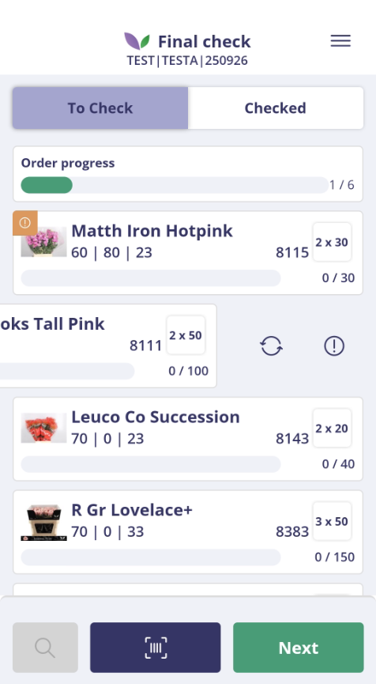

 
### Barcodes en telstrategie

| Policy | Werking |
| --- | --- |
| `BarcodeDecodeOptions` | Selecteert welke barcodetypen herkend worden. Kies alleen de typen die in uw proces worden gebruikt. |
| `CountingStrategy` | `Kolli` telt per colli, `EntireOrderItem` controleert het volledige orderitem en `Barcode` gebruikt het aantal uit de barcode. |
| `StoreScannedBarcodes` | Slaat scans op in de tabel `BARCODES` en controleert op eerder gescande barcodes. Gebruik dit voor unieke stickers. Bij herhaald scannen van een niet-unieke partijbarcode kan deze controle verdere telling blokkeren. |
| `AllowScanningRedistributedBarcodes` | Accepteert bij herverdeelde orderregels ook de oorspronkelijke barcode uit `FromBarcode`, naast de nieuwe barcode. |

Beschikbare barcodetypen zijn `OrderItemDetailBarcode` (karbarcode), `OrderItemBarcode`, `PickorderCvar15Barcode`, `FinalCheckBarcode`, `FsqrCode`, `CustomerIdBarcode`, `StockItemCvar7Barcode`, `VStockItemIdBarcode`, `BoxBarcode` en `PickingListBarcode`.

Bij `Barcode` moet de barcode een aantal bevatten. Ontbreekt dat, dan toont de app een melding dat telstrategie en barcode niet bij elkaar passen en wordt de scan niet als telling verwerkt. Met `VStockItemIdBarcode` kunt u binnen de actieve selectie op V-partijnummer controleren; bij meerdere nog te controleren resultaten kiest u de juiste orderregel.

Bij de huidige verwerking van meerdere scanresultaten wordt na de keuze van een orderregel geen barcodeaantal meegegeven. Daardoor kan bij telstrategie `Barcode` ook na een geldige scan de melding over een ontbrekend aantal verschijnen. Gebruik dan een passende scanroute met één resultaat of registreer de controle handmatig.

Een barcode zonder resultaat binnen de actieve selectie wordt afgekeurd. Zijn alle overeenkomende regels al gecontroleerd, dan meldt de app dat de controle al is afgerond. De selecties **To check** en **Checked** tonen respectievelijk open en gecontroleerde regels; gedeeltelijk gecontroleerde regels kunnen in beide lijsten voorkomen. Gebruik de verversactie om de actuele stand opnieuw op te halen.

### Acties bij een orderregel

Tik op een orderregel om de productdetails te openen. Veeg een regel opzij om de beschikbare acties te tonen: **handmatig controleren**, **productsticker printen**, **resetten** of **afwijking registreren**. De beschikbare acties hangen af van de controlestatus, policies en toegang tot de geïntegreerde functies. Bij een volledig gecontroleerde regel blijven printen en, indien toegestaan, resetten beschikbaar; handmatige telling en afwijkingsregistratie zijn bedoeld voor regels met nog te controleren aantallen.

Het menu van het controleoverzicht bevat, indien toegestaan, ook **Alles controleren** en **Alle gecontroleerde regels resetten**. Deze acties werken op de volledige actieve selectie en vragen om bevestiging. Met de juiste inrichting is in dit menu ook **Adreslabel afdrukken** beschikbaar als snelkoppeling naar de geïntegreerde labelfunctie.

Het te controleren aantal kan lager zijn dan het oorspronkelijke orderaantal door geregistreerde afwijkingen die het aantal verlagen en door gekoppelde creditregels. De app trekt vervolgens het al gecontroleerde aantal af om het restant te bepalen. Controleer bij een onverwacht restant daarom ook de afwijkingen en creditregels; registreer dezelfde hoeveelheid niet nogmaals als controle.

### Tijdens de controle van selectie wisselen

Scan vanuit het controleoverzicht een klantbarcode om een andere klantselectie op te zoeken, of een paklijstbarcode om naar die paklijst te gaan wanneer paklijstverwerking is ingericht. Bij een onvolledige controle kan eerst de waarschuwing van `ShowWarningIfIncomplete` verschijnen. Kies **Nee** om bij de huidige controle te blijven of bevestig om door te gaan. De al geregistreerde voortgang blijft bewaard.

Wanneer `StoreScannedBarcodes` aan staat, richt u ook het opruimen van de tabel in via **Constanten → Timer → Tabellen opschonen**. Voeg `BARCODES` toe en kies een passende bewaartermijn, bijvoorbeeld 90 dagen. Dit is een ander proces dan het opschonen van fotobestanden.

### Productdetails en status bekijken

Per orderregel is het mogelijk om de **productdetails** te openen. In dit scherm worden aanvullende gegevens van het artikel weergegeven.

Onderdeel van deze productdetails is de **statuspagina**. Deze pagina geeft inzicht in de logistieke voortgang van het artikel en is gebaseerd op de acties die zijn vastgelegd in het partijlog.

Met `OrderOverview_AvailableProductDetails` kiest u de details en hun volgorde. Beschikbaar zijn **Aantal**, **Lengte**, **Debiteur**, **Leverancier**, **Picktijd**, **Picker naam**, **Fustcode**, **Fustaantal**, **Fustomschrijving**, **Voorraadcode**, **Voorraadomschrijving**, **S2** en **Subdebiteur naam**. Dit zijn gegevens ter inzage in het productdetail.

De gedeelde policy `Apps_Logistics_ShowLogisticStatusOptions` bepaalt welke logistieke statussen worden getoond: binnen gemeld, op locatie, order gepickt, ingepakt, op de kar geladen en eindcontrole uitgevoerd. De statuspagina toont de bijbehorende loggegevens. Als de lijst leeg is, wordt de statuslog niet getoond.

<b>Klik hier voor een voorbeeld!</b>
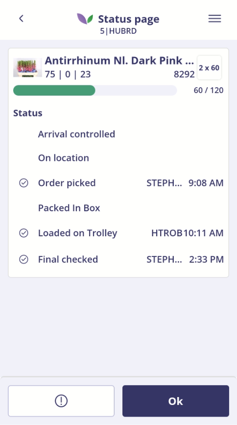

 

### Productsticker opnieuw printen

Ontbreekt een productsticker of is deze beschadigd? Open dan de productdetails van de betreffende orderregel en kies het **printicoon**. De app verstuurt een nieuwe printopdracht voor alle bijbehorende kolli naar de ingestelde printer. De eindcontrolestatus en de voortgang van de orderregel veranderen hierdoor niet.

De policy-groep `Printer` bevat:

| Policy | Werking |
| --- | --- |
| `IsActive` | Staat het opnieuw printen van productstickers toe. |
| `PickItemLabelLayout` | Selecteert de lay-out voor pickorder-prijsstickers (`PickOrderPrijsSticker`). |
| `PickItemLabelPrinter` | Selecteert de printer waarnaar de stickers worden verstuurd. |

De printerfunctie moet actief zijn en zowel printer als lay-out moeten zijn ingesteld. Bij ontbrekende inrichting of een mislukte printopdracht toont de app een melding.

### Handmatige eindcontrole van orderregels

Als het scannen van een orderregel niet mogelijk is, kan de controle ook handmatig worden uitgevoerd.
Kies de handmatige controle bij de orderregel. De app stelt het nog te controleren aantal voor. Voer het werkelijk gecontroleerde aantal in en bevestig; het aantal moet groter dan nul zijn. Met annuleren keert u terug zonder deze telling te registreren. De handmatige controle wordt visueel weergegeven in het scherm.

Wanneer een orderregel handmatig wordt gecontroleerd, wordt dit in de Backoffice bij de betreffende factuurregel automatisch vastgelegd. Het veld _Handm.Eindgecontroleerd_ wordt hierbij aangevinkt en de handmatige controle wordt tevens geregistreerd in het partijlog.

<b>Klik hier voor een voorbeeld!</b>
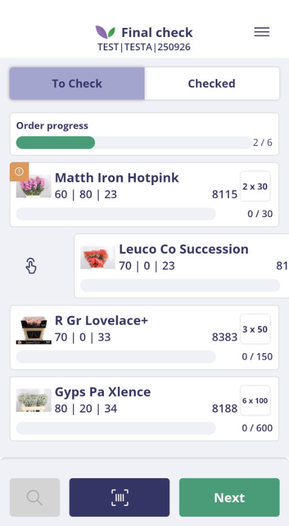

 

<b>Klik hier voor een voorbeeld!</b>
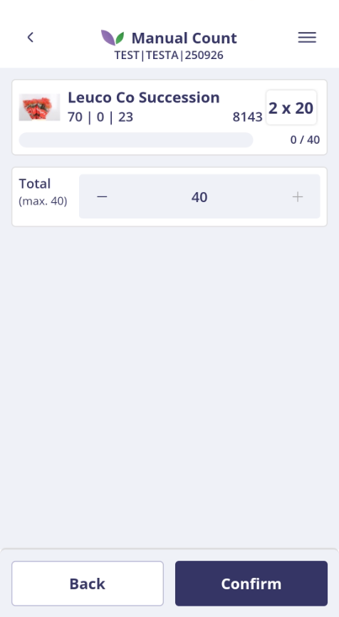

 

Als er een probleem is met een orderregel, kunt u via **Exception Registration** een afwijking registreren. Hiervoor moet `ExceptionRegistration` in `Addons_EnableAddons` staan en moet de geïntegreerde functie beschikbaar zijn. Dit kan alleen voor het nog niet gecontroleerde aantal. Na terugkeer worden de gegevens en resterende aantallen opnieuw geladen.

De gedeelde policy `Apps_Logistics_QualityControl_SetExceptionReasons` bepaalt welke redenen beschikbaar zijn. Een lege selectie levert geen redenen op. Raadpleeg voor de verdere inrichting en werkwijze de [handleiding Exception Registration](../Exception%20Registration/Quickstart%20Handleiding%20NL.md).

<b>Klik hier voor een voorbeeld!</b>
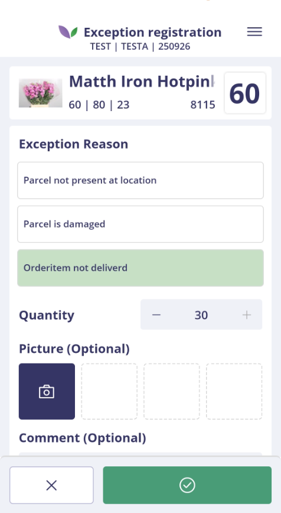

 

Met `AllowCompleteEntireTarget` kan de gebruiker de volledige actieve selectie in één keer als gecontroleerd verwerken, zonder iedere regel afzonderlijk te scannen. De app vraagt hiervoor eerst om bevestiging. Controleer vooraf of dit voor alle orders binnen de gekozen groepering bedoeld is.

<b>Klik hier voor een voorbeeld!</b>
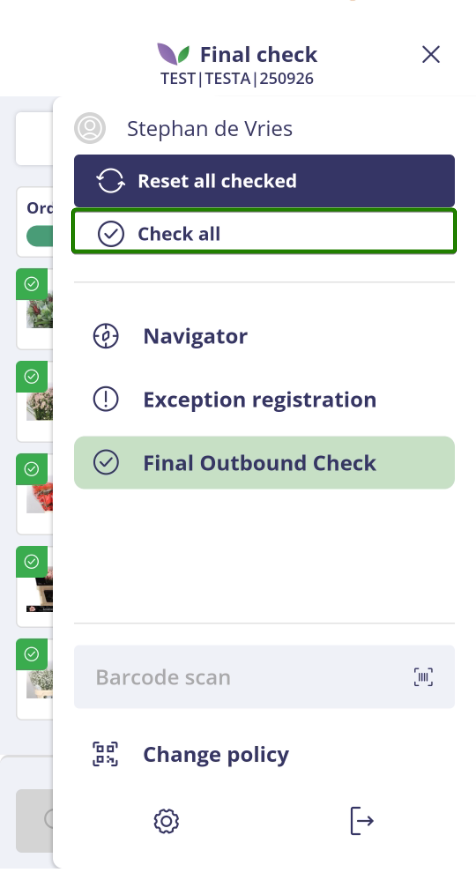

### Dozen controleren

Open de doosdetails om de inhoud te bekijken. Met `RequireBoxInspection` bepaalt u of dozen afzonderlijk moeten worden gecontroleerd:

- **Aan:** scan de doos of keur deze handmatig goed, ook wanneer de inhoud al is gecontroleerd.
- **Uit:** een doos hoeft niet apart te worden gecontroleerd wanneer de bijbehorende regels volledig zijn verwerkt. De app rondt zulke dozen af tijdens de verdere afhandeling van de scope.

Bij een expliciete dooscontrole verwerkt de app ook de nog niet eindgecontroleerde aantallen van de bijbehorende factuurregels. De ingestelde handmatige/scanwijze bepaalt de registratie; controleer de verwerking in de Backoffice.

## Stap 4: Order afronden

Wanneer alle vereiste orderregels en dozen gecontroleerd zijn, is de actieve selectie afgerond en staan de verwerkte items onder **Checked**.

<b>Klik hier voor een voorbeeld!</b>
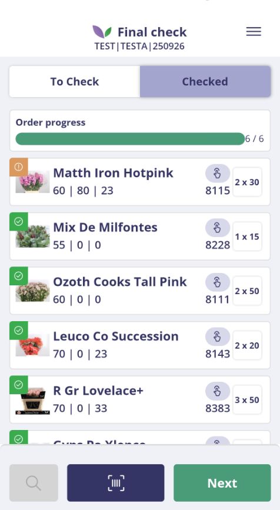

 
Daarbij worden ook diverse gegevens bijgewerkt in **Backoffice → Facturen**. Deze gegevens staan op de betreffende factuurregel (`ORDERREG`) en kunnen als kolommen worden gebruikt om de eindcontrole achteraf te controleren:

| Kolom (`ORDERREG`) | Wat wordt vastgelegd? |
| --- | --- |
| `EINDCHECK` | Het aantal dat met de Final Outbound Check is gecontroleerd. |
| `SCAN_USER` | De gebruikers-ID van de ingelogde gebruiker die de eindcontrole heeft geregistreerd. |
| `SCAN_DATE` | De datum waarop de eindcontrole is geregistreerd. |
| `SCAN_TIME` | Het tijdstip waarop de eindcontrole is geregistreerd. |
| `CONTROLEUR` | De medewerkers-ID/verkoperscode van de controleur. |
| `SCAN_HAND` | Geeft aan dat de orderregel handmatig is gecontroleerd. Dit veld wordt alleen bij een handmatige controle aangezet. |

De gebruikers-, datum-, tijd- en controleurgegevens worden gevuld wanneer deze op de factuurregel nog leeg zijn. Bij het eindcontroleren van een doos worden ook de nog niet eindgecontroleerde aantallen van de bijbehorende factuurregels verwerkt. Hierdoor zijn deze kolommen ook bruikbaar om controles van producten in dozen achteraf na te gaan.

Daarnaast zijn er extra mogelijkheden:

| Policy | Werking |
| --- | --- |
| `AllowResetOrderItem` | Maakt resetten van een orderregel, en de resetactie bij dozen, beschikbaar. De app vraagt eerst om bevestiging en laadt daarna de controle opnieuw. |
| `AllowResetEntireTarget` | Staat toe de volledige actieve selectie opnieuw vrij te geven voor controle. Bij een groepsscope kan dit meerdere orders raken. Ook hiervoor vraagt de app om bevestiging. |
| `AllowCompleteEntireTarget` | Staat de eerder beschreven volledige controle in één handeling toe. |

Resetten is bedoeld om opnieuw te controleren; het verwijdert geen order of orderregel.

<b>Klik hier voor een voorbeeld!</b>
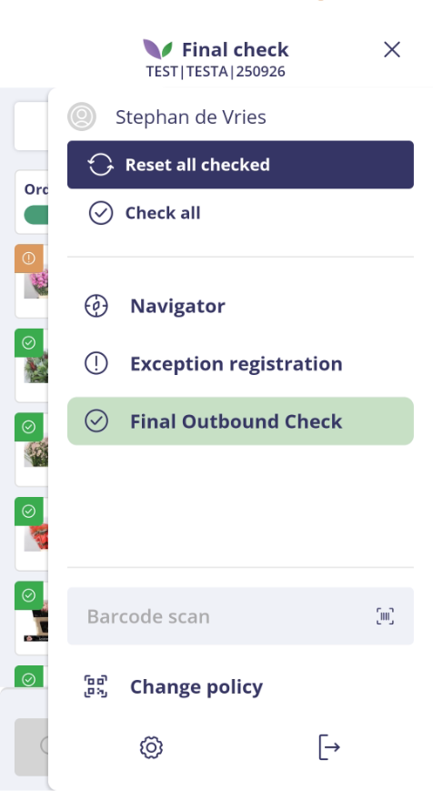

 
Kies **Next** om de aanvullende acties te openen. Met `EnableAddons` in de groep `Addons` (`Addons_EnableAddons`) bepaalt u welke integraties worden aangeboden. De ingestelde lijstvolgorde bepaalt de volgorde van de acties; zonder selectie worden geen aanvullende acties aangeboden.

U hoeft het scherm niet te verlaten om nog iets na te kijken: tik op **Check** bij de voortgang om terug te keren naar het controleoverzicht. Met de startknop gaat u naar een volgende controle; bij een onvolledige selectie kan eerst de ingestelde waarschuwing verschijnen.

| Waarde | Mogelijkheid en voorwaarden |
| --- | --- |
| `Photos` | Foto’s aan de actieve selectie toevoegen. Zie de aparte [handleiding Foto’s maken en beheren](../../Additional%20actions/Photos/Handleiding%20foto%27s%20maken%20en%20beheren%20-%20NL.md). |
| `ExceptionRegistration` | Een afwijking registreren vanuit een nog te controleren orderregel. Deze actie staat bij de regel/productdetails, niet als gewone afrondactie in het aanvullende-actiesoverzicht. |
| `AdressLabel` | Een adreslabel voor de klant of hub printen. Vereist toegang tot Address Label en de bijbehorende Shipping-policies. Niet beschikbaar vanuit een afzonderlijke paklijstscope. |
| `Returnables` | Uitgaand fust registreren via Returnables Outbound. De integratie moet beschikbaar zijn en er moet een geldige fustdebiteur/ordercontext kunnen worden bepaald. |
| `ApproveInvoices` | De facturen binnen de actieve selectie akkoord geven voor verdere verwerking. |
| `CMR` | Een CMR-afdruk inplannen voor een klant/hub met groepering op één ordernummer. |

Voor Address Label moeten onder **Apps → Logistics → Shipping → AddressLabels → PrinterSetting** ook de printer en het rapport zijn ingericht. `ReportName` accepteert alleen lay-outs van lijstsoort `Stickers` of `AdresSticker`. Raadpleeg de [handleiding Address Label](../../App%20Shipping/Adress%20Label/Handleiding%20Address%20Label%20-%20NL.md).

Voor fustregistratie gebruikt de app de inrichting van Returnables Outbound, inclusief de bepaling van de fustdebiteur en het ordernummer. Raadpleeg de [handleiding Returnables Outbound](../../App%20Returnables/Returnables%20Outbound/Handleiding%20Returnables%20Outbound%20-%20NL.md).

### Foto-opslag en bewaartermijn

| Policy onder `Addons` | Werking |
| --- | --- |
| `PhotoStorageDirectoryPath` | Optionele afwijkende foto-opslagmap. Laat deze leeg voor de standaardarchiefmap in de datafolder. Gebruik bij een afwijking een bereikbaar netwerkpad, bijvoorbeeld `\\server\share\pictures\FinalOutboundCheck`; de cloudserver heeft lees- en schrijfrechten nodig en Backofficegebruikers leesrechten. |
| `PhotoStorageRetentionDays` | Bewaartermijn in dagen. De policy heeft standaardwaarde `100`. Verwijderen gebeurt pas via het timerproces **App foto’s opschonen**. Controleer de effectieve policywaarde van de timergebruiker. |

De volledige bediening, opslag en inrichting van het opruimproces staan in de aparte [handleiding Foto’s maken en beheren](../../Additional%20actions/Photos/Handleiding%20foto%27s%20maken%20en%20beheren%20-%20NL.md). Deze gedeelde handleiding blijft de bron voor de fotofunctie.

### CMR afdrukken

Schakel `CMR` in bij `Addons_EnableAddons`. De actie is beschikbaar bij een klant- of hubscope die op `OrderNumber` is gegroepeerd, en niet bij een paklijstscope of een orderverzameling zonder één ordernummer.

Kies **CMR afdrukken** om de afdruk in de bestaande wachtrij te plaatsen. De Backoffice-printer, lay-out en het bijbehorende timerproces verwerken de opdracht. De melding dat de afdruk is ingepland bevestigt de wachtrijopdracht; controleer vervolgens de daadwerkelijke afdruk. Is een order al ingepland of geprint, dan volgt de bestaande terugmelding; bij een hub kan een deel van de orders al verwerkt zijn.

Wanneer regels of dozen nog niet volledig gecontroleerd zijn, vraagt de huidige app of u de CMR toch wilt afdrukken. Dit is een waarschuwing met een keuze om door te gaan, geen automatische blokkade.

De policy `RequireSignature` is bedoeld voor een handtekening bij het printen/mailen van de CMR. In de huidige Final Outbound Check-flow wordt deze policy niet gebruikt om een digitale handtekening te vragen of af te dwingen. Gebruik deze instelling daarom niet als garantie dat een handtekening vereist is.

### Facturen akkoord geven

Nadat de logistieke eindcontrole is afgerond, kunt u de factuur vrijgeven om door te boeken. Schakel hiervoor in de Final Outbound Check-policy bij `Addons_EnableAddons` de optie **Facturen akkoord geven** in. Rond de actieve scope af, open de aanvullende acties en kies **Facturen akkoord geven**.

De app legt per geraakte orderkop de datum, tijd en ingelogde gebruiker vast. Bij een hub, datumgroepering of andere groepsscope worden alle orders binnen de actieve scope verwerkt. Als u de actie opnieuw uitvoert, worden deze gegevens opnieuw met de actuele datum, tijd en gebruiker vastgelegd.

### Foto's op de factuur tonen

Foto's die tijdens Final Outbound Check zijn opgeslagen, kunnen aan de factuurlay-out worden toegevoegd.

1. Voeg de tabel `FinalOutboundCheckPhotos.DBF` aan de factuurlay-out toe.
2. Gebruik de velden `PHOTOPATH1` tot en met `PHOTOPATH8`. Deze bevatten maximaal de laatste acht foto's die bij de factuur horen; ongebruikte velden blijven leeg.
3. Voeg voor ieder gebruikt fotoveld een afbeeldingselement toe en laat het script beginnen met `URL :=`, bijvoorbeeld `URL := FinalOutboundCheckPhotos.PHOTOPATH1`.
4. Controleer in het afdrukvoorbeeld dat alleen de foto's van de betreffende factuur worden getoond.

De cloudserver moet de gebruikte foto-opslagmap kunnen lezen. Zie [Foto-opslag en bewaartermijn](#foto-opslag-en-bewaartermijn) voor de bijbehorende policies en de verwijzing naar de gedeelde fotohandleiding.

### Foto's terugzoeken in de Backoffice

De foto's van een uitgevoerde Final Outbound Check kunnen ook rechtstreeks vanuit **Facturen** en **Factuurhistorie** worden bekeken.

1. Selecteer de betreffende factuur.
2. Open het snelmenu van de factuur.
3. Kies **Final outbound check foto's weergeven**.

Alle foto's die bij de geselecteerde factuur horen, worden geopend. De Backoffice gebruikt hiervoor de alternatieve archiefmap uit de policy `Apps_Logistics_QualityControl_FinalOutboundCheck_Addons_PhotoStorageDirectoryPath`. Is deze niet ingesteld, dan wordt de standaardarchiefmap van Final Outbound Check gebruikt. De gebruiker moet leestoegang tot de gebruikte map hebben.

 

<b>Klik hier voor een voorbeeld!</b>
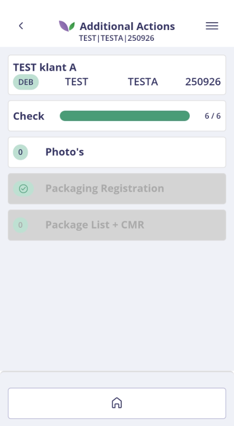

 
Met `ShowWarningIfIncomplete` verschijnt bij het verlaten van een onvolledige controle of het wisselen van selectie een waarschuwing. U kunt teruggaan om verder te controleren of bevestigen dat u wilt stoppen. De geregistreerde voortgang blijft bewaard, zodat u later verder kunt gaan; de waarschuwing rondt de resterende regels niet automatisch af.

 

<b>Klik hier voor een voorbeeld!</b>
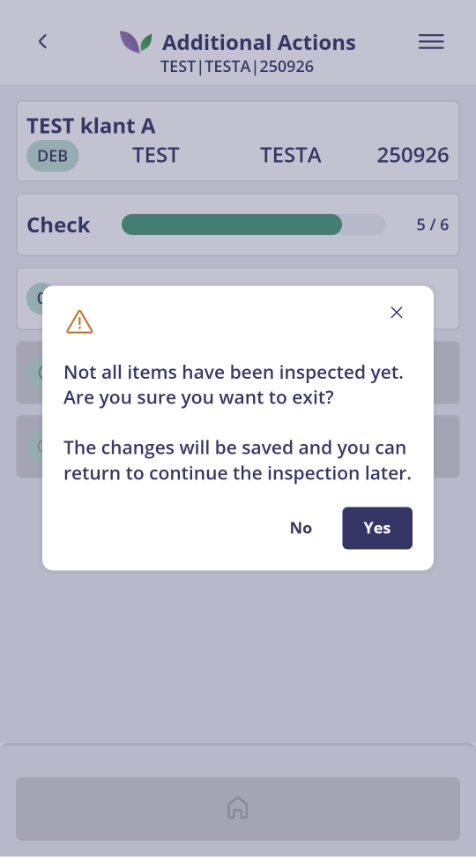

---

## Waar vindt u de Final Outbound Check-policies?

| Stap | Uitleg |
| --- | --- |
| **1** | Open het constantenscherm in de Backoffice via de navigator. |
| **2** | Navigeer naar **Systeem → Users → Policy Beheer**. |
| **3** | Selecteer of maak een policy aan en open **Apps → Logistics → QualityControl → FinalOutboundCheck**. |
| **4** | Open voor de aanvullende instellingen **OrderOverview**, **OrderOverview → Filters**, **Addons** of **Printer**. |

De policynamen in deze handleiding zijn relatief aan deze route. `OrderOverview_Filters_ScopeDateFilterType` is bijvoorbeeld de volledige sleutel `Apps_Logistics_QualityControl_FinalOutboundCheck_OrderOverview_Filters_ScopeDateFilterType`.

`Apps_Logistics_ShowLogisticStatusOptions` staat onder **Apps → Logistics** en `Apps_Logistics_QualityControl_SetExceptionReasons` onder **Apps → Logistics → QualityControl**. Geïntegreerde modules zoals Address Label, Returnables Outbound en Exception Registration hebben daarnaast hun eigen inrichting en toegangsvoorwaarden. Controleer steeds de effectieve policies van de gebruiker en situatie en laad gewijzigde configuratie opnieuw.

Raadpleeg voor algemeen beheer de [handleiding Policy Management](https://github.com/florisoft/User.Manuals/blob/main/BASIS/Policy%20Management/Handleiding%20Policy%20Management%20NL.md).
