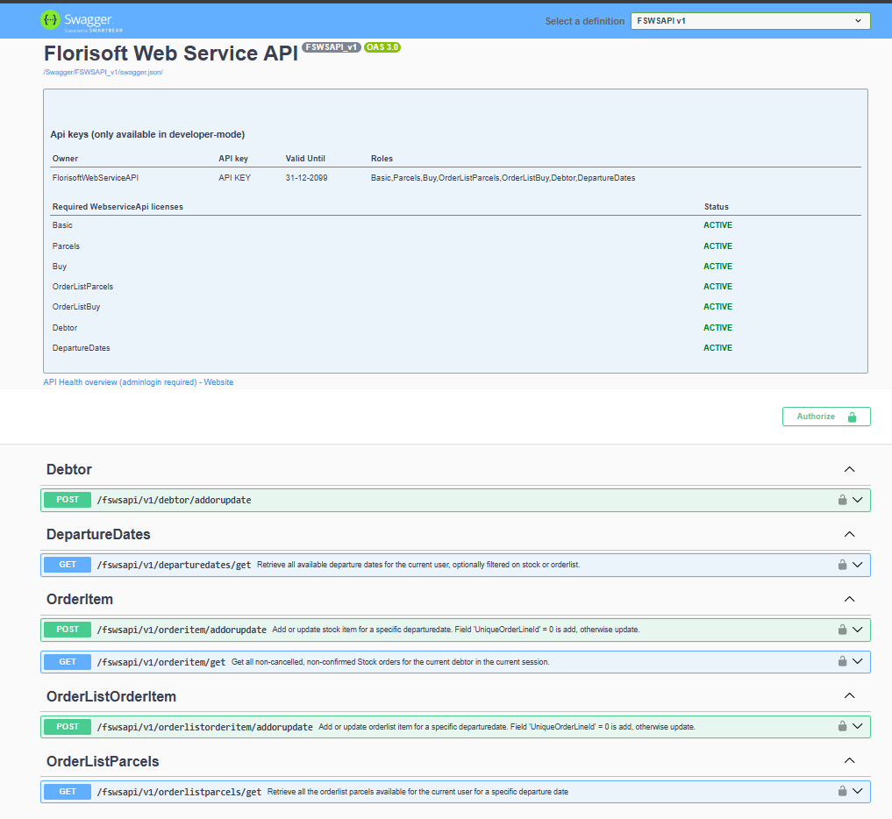
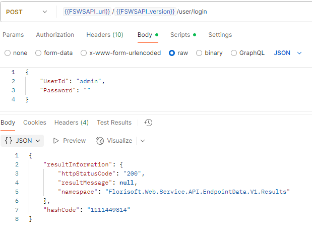
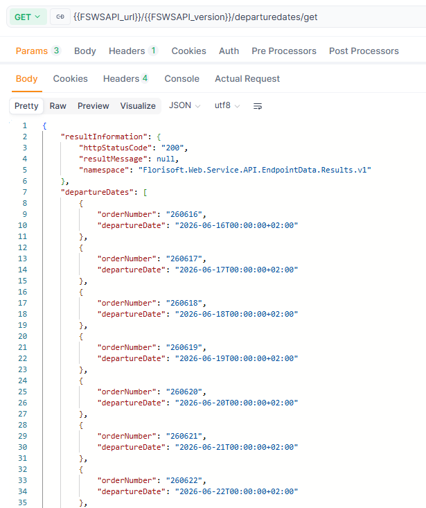
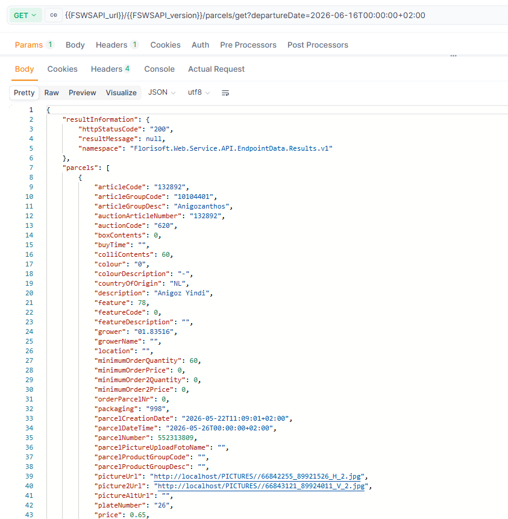

# Florisoft Webservice API (M234)

The Florisoft Webservice API allows an external application to retrieve available stock and order-list parcels, place or update orders, and confirm them. This manual is intended for developers and application administrators who integrate with the API.

The examples use API version `v1`. The Swagger page in your own environment is always the leading reference for the exact request and response model available there.

## Contents

- [Prerequisites](#prerequisites)
- [Swagger and base URL](#swagger-and-base-url)
- [Authentication and headers](#authentication-and-headers)
- [Date format](#date-format)
- [Rate limiting](#rate-limiting)
- [Endpoint overview](#endpoint-overview)
- [User login](#user-login)
- [Departure dates](#departure-dates)
- [Stock parcels and orders](#stock-parcels-and-orders)
- [Order lists and orders](#order-lists-and-orders)
- [Administrative negative orders](#administrative-negative-orders)
- [Renamed response fields](#renamed-response-fields)
- [Testing and troubleshooting](#testing-and-troubleshooting)

## Prerequisites

Before using the API, check that:

- the Webservice API is installed and running in IIS;
- an API key has been issued for the integration;
- the Florisoft user has access to the correct stocks and order lists;
- the user is not blocked for delivery (`LEVSTOP`);
- the user has access to the Webservice API (`TOEGANGWS`);
- the required licences are active.

The available endpoint groups depend on the active licence:

| Licence | Purpose |
|---|---|
| `Basic` | Login and basic API operation |
| `Parcels` | Retrieve stock parcels |
| `Buy` | Add, update and confirm stock orders |
| `OrderlistParcels` | Retrieve order lists and order-list parcels |
| `OrderlistBuy` | Add, update and confirm order-list orders |

Contact Florisoft if an endpoint is missing from Swagger or returns an authorisation error even though the request is valid.

## Swagger and base URL

Open the root URL of the Webservice API in a browser to view Swagger. Swagger shows the endpoints and models available in the installed version and can be used to test requests after supplying the API key.

<details><summary><b>Show an example of the Swagger overview</b></summary></details>

Every endpoint path must be preceded by the base URL of your own environment. For example:

```text
https://localhost:7179/fswsapi/v1/user/login
```

Replace `https://localhost:7179/fswsapi` with the URL supplied for your environment.

## Authentication and headers

Include the API key in every request:

```http
x-api-key: <your API key>
```

Start a session with `POST /fswsapi/v1/user/login`. A successful response contains a hash code. Include this code in every subsequent request:

```http
UserHashCode: <hash code returned by login>
```

Do not include real API keys, passwords or hash codes in documentation, tickets or log excerpts.

## Date format

Unless Swagger specifies otherwise for a field, use an ISO 8601 date and time with time-zone offset:

```text
yyyy-MM-ddTHH:mm:sszzz
```

Example:

```text
2026-06-15T00:00:00+02:00
```

## Rate limiting

Requests are rate-limited per `UserHashCode`. By default, a user can briefly use a bucket of 20 tokens. One token is added every second and a normal request costs one token.

If no token is available, the API returns:

```http
429 Too Many Requests
```

Wait before retrying and use a controlled retry strategy with backoff. Do not immediately repeat a large batch of rejected requests.

The defaults can be adjusted by an administrator through Webshop settings in the `CONFIG` section:

| Setting | Default | Purpose |
|---|---:|---|
| `WSAPIRATELIMITTOKENLIMIT` | `20` | Maximum bucket size per user |
| `WSAPIRATELIMITDEFAULTTOKENCOST` | `1` | Token cost of a normal request |
| `WSAPIRATELIMITTOKENSPERPERIOD` | `1` | Tokens added per period |
| `WSAPIRATELIMITREPLENISHSECONDS` | `1` | Period length in seconds |
| `WSAPIRATELIMITTOKENQUEUELIMIT` | `0` | Number of queued requests |
| `WSAPIRATELIMITREJECTSTATUSCODE` | `429` | Status code when a request is rejected |
| `WSAPIRATELIMITEXCLUDEDPATH` | `/swagger` | Path excluded from rate limiting |

Rejected requests are recorded as warnings in the Health Log.

## Endpoint overview

| Method | Endpoint | Purpose |
|---|---|---|
| `POST` | `/user/login` | Start an authenticated user session |
| `GET` | `/departureDates/get` | Retrieve available departure dates |
| `GET` | `/parcels/get` | Retrieve available stock parcels |
| `POST` | `/orderItem/addOrUpdate` | Add, update or remove a stock order line |
| `GET` | `/orderItem/get` | Retrieve open stock order lines in the current session |
| `POST` | `/orders/confirm` | Confirm stock order lines |
| `GET` | `/orderLists/get` | Retrieve available order lists |
| `GET` | `/orderListParcels/get` | Retrieve available order-list parcels |
| `POST` | `/orderListOrderItem/addOrUpdate` | Add, update or remove an order-list line; also used for administrative negative orders |
| `POST` | `/orders/confirmOrderlist` | Confirm order-list lines |

> `parcels/get`, `orderLists/get` and `orderListParcels/get` are `GET` endpoints. Older integrations may still use `POST` with a JSON body; move these parameters to the query string.

## User login

### `POST /fswsapi/v1/user/login`

Use this endpoint before calling the other endpoints.

```json
{
  "userId": "<user id>",
  "password": "<password>"
}
```

A login can fail when the credentials are incorrect, the user is blocked for delivery (`LEVSTOP`) or the user has no Webservice API access (`TOEGANGWS`). Store the returned hash code only for the duration required by the integration.

<details><summary><b>Show an example login response</b></summary></details>

## Departure dates

### `GET /fswsapi/v1/departureDates/get`

Use this endpoint to retrieve all available departure dates or filter them by stock or order list.

| Query parameter | Required | Description |
|---|---|---|
| `listType` | No | `0` = all, `1` = stock, `2` = order list |
| `listCode` | No* | Stock code or order-list code |
| `sublistCode` | No | Order-list subcode; only applicable to `listType=2` |

*When `listCode` is supplied, `listType` is required.

Examples:

```http
GET /fswsapi/v1/departureDates/get
GET /fswsapi/v1/departureDates/get?listType=1&listCode=STO1
GET /fswsapi/v1/departureDates/get?listType=2&listCode=ORD1
GET /fswsapi/v1/departureDates/get?listType=2&listCode=ORD1&sublistCode=SUB2
```

The response contains `orderNumber` and `departureDate` for every available date.

<details><summary><b>Show an example departure-date response</b></summary></details>

## Stock parcels and orders

### Retrieve stock parcels

```http
GET /fswsapi/v1/parcels/get?departureDate=2026-06-15T00:00:00+02:00
```

`departureDate` is required. The response contains the stock parcels available to the current user. If none are available, the collection is empty.

<details><summary><b>Show an example parcel response</b></summary></details>

### Add, update or remove a stock order line

```http
POST /fswsapi/v1/orderItem/addOrUpdate
```

Required request fields:

- `parcelNumber`: use the value returned by `parcels/get`;
- `departureDate`;
- `orderedQuantity`;
- `uniqueOrderLineId`.

Use `0` for `uniqueOrderLineId` when creating a line. For a later change or removal, use the identifier returned by the first `addOrUpdate` call.

Optionally include `groupId` as a UUID to group related order lines:

```json
{
  "parcelNumber": 12345,
  "departureDate": "2026-06-15T00:00:00+02:00",
  "orderedQuantity": 10,
  "uniqueOrderLineId": 0,
  "groupId": "aa40f903-2cdd-45e6-b8b8-013d5ff29732"
}
```

### Retrieve open stock order lines

```http
GET /fswsapi/v1/orderItem/get
```

This endpoint returns the non-cancelled, non-confirmed stock order lines for the current debtor in the current session.

### Confirm stock orders

```http
POST /fswsapi/v1/orders/confirm
```

Without a body, this confirms all current stock order lines. To confirm only one group, provide its `groupId`:

```json
{
  "groupId": "aa40f903-2cdd-45e6-b8b8-013d5ff29732"
}
```

## Order lists and orders

### Retrieve order lists

```http
GET /fswsapi/v1/orderLists/get?departureDate=2026-06-15T00:00:00+02:00
```

`departureDate` is required. The response contains the order lists available to the user for that departure date.

### Retrieve order-list parcels

```http
GET /fswsapi/v1/orderListParcels/get?departureDate=2026-06-15T00:00:00+02:00&orderListCode=ORD1&orderListSubCode=SUB2
```

`departureDate` is required. `orderListCode` and `orderListSubCode` can be supplied to limit the result. The response is empty when no matching parcel is available.

### Add, update or remove an order-list line

```http
POST /fswsapi/v1/orderListOrderItem/addOrUpdate
```

Required request fields:

- `orderListCode` and `orderListSubCode`, as returned by `orderListParcels/get`;
- `parcelNumber`, as returned by `orderListParcels/get`;
- `departureDate`;
- `orderedQuantity`;
- `uniqueOrderLineId`.

Use `0` for `uniqueOrderLineId` when creating a line and the returned identifier when changing or removing it.

### Confirm order-list orders

```http
POST /fswsapi/v1/orders/confirmOrderlist
```

This confirms the current order-list lines. Do not use the regular confirmation flow for an administrative negative order; see the next section.

## Administrative negative orders

The API can register a negative order-list line for administrative invoicing, for example for a return or credit. This is not a normal purchase: it does not purchase or allocate stock. The line is registered directly for later processing to an invoice in Florisoft Backoffice.

> Test this flow with your Florisoft administrator or consultant before using it in production. The source parcel determines important invoice information, including the price. A source price of `0` results in a credit line of `0`.

### Additional configuration

In addition to the normal API authentication, the following must be configured:

- licence/role `OrderListBuy`;
- Webshop setting `BESTEL - WSAPIALLOWNEGATIVEORDERS` set to `ON`;
- Backoffice policy `SendOrdersWithNegativeOriginalToInvoices` set to `true`.

Have an authorised administrator or Florisoft consultant verify these settings and the intended invoice result.

### Register a negative order

Use the normal order-list endpoint:

```http
POST /fswsapi/v1/orderListOrderItem/addOrUpdate
```

Example request:

```json
{
  "departureDate": "2026-08-18",
  "orderedQuantity": -120,
  "parcelNumber": 110,
  "orderListCode": "1",
  "orderListSubCode": ""
}
```

Conditions:

- `orderedQuantity` must be less than `0`;
- `parcelNumber` must refer to an existing, available order parcel;
- `departureDate` must be valid;
- `orderListCode` and `orderListSubCode` must identify the intended order list.

The debtor is determined from the authenticated user.

On success, the API returns HTTP `200`, for example:

```json
{
  "negativeOrderRegistrationResult": {
    "succeeded": true,
    "message": "Negative order registered successfully for administrative invoicing. ID: 167",
    "orderId": 167
  }
}
```

When the parcel cannot be found, the API returns HTTP `412`, for example:

```json
{
  "negativeOrderRegistrationResult": {
    "succeeded": false,
    "message": "Negative order could not be registered because no order parcel was found for parcel number: 999",
    "orderId": null
  }
}
```

### Important safeguards

- Every negative request currently creates a new administrative line.
- `uniqueOrderLineId` is not used to update an existing negative line or to make the request idempotent.
- Do not retry a request automatically after an uncertain result without first checking whether the line was created; otherwise a duplicate credit line can be produced.
- Verify the price, quantity, packaging information, debtor and invoice result in Backoffice before further processing.
- Keep the line out of normal stock delivery and allocation flows.

## Renamed response fields

Use the current field names in new integrations.

### Parcel

| Previous field | Current field |
|---|---|
| `AmountPerBunch` | `QuantityPerBunch` |
| `AmountPerLayer` | `QuantityPerLayer` |
| `AmountPerCarrier` | `QuantityPerCarrier` |
| `IsBinnen` | `Received` |
| `MinimumOrder` | `MinimumOrderQuantity` |
| `MinimumOrder2` | `MinimumOrder2Quantity` |
| `MinimumOrderPrice2` | `MinimumOrder2Price` |
| `SendingHeaderID` | `SupplyHeaderId` |

`SupplyHeaderId` is populated only when `DEBITEUR.WSAVKOPID` is enabled.

### Order-list parcel

| Previous field | Current field |
|---|---|
| `MinimumOrderQuantity2` | `MinimumOrder2Quantity` |
| `MinimumOrderPrice2` | `MinimumOrder2Price` |

## Testing and troubleshooting

Before going live:

1. Open Swagger and verify that the required endpoints are available.
2. Log in with a dedicated test user and check the returned hash code.
3. Retrieve departure dates and parcels for a known test date.
4. Create an order line with `uniqueOrderLineId: 0`, then update it with the returned identifier.
5. Confirm the intended order and verify the result in Florisoft.
6. For negative orders, verify the complete credit or return result in Backoffice before enabling automated use.

Common responses:

| Response | Check |
|---|---|
| Login fails | Credentials, `LEVSTOP` and `TOEGANGWS` |
| `401` or `403` | API key, `UserHashCode`, licence and user access |
| `412` for a negative order | Whether the requested order parcel exists and is available |
| `429` | Reduce request rate and retry later with backoff |
| Empty collection | Departure date, stock/order-list access and filter values |

If the installed Swagger model differs from this manual, stop the integration change and contact Florisoft to establish which API version and configuration are active.
